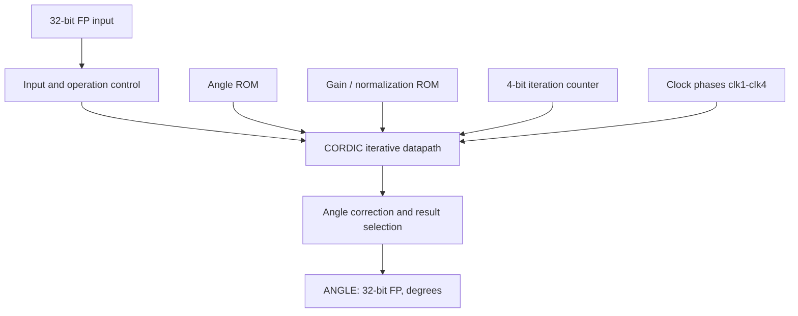

# Anti-cordic
Gate-level FP32 CORDIC circuit in Logisim Evolution that computes asin and acos, returning the angle in degrees. Uses 16-entry ROM lookup tables, a 4-bit iteration counter, and a multi-phase clocked datapath.

# FP32 CORDIC ASIN & ACOS in Logisim Evolution

A gate-level circuit that computes inverse sine (`asin`) and inverse cosine (`acos`) using an iterative CORDIC datapath. All signals are 32-bit IEEE 754 floating point, and the result is returned in degrees.

The project translates an iterative numerical algorithm into a working logic-level design: floating-point arithmetic, lookup ROMs, registers, multi-phase control, and angle correction, all built in Logisim Evolution.

**Status:** Functional over the tested operating region, with roughly 99.89% reported accuracy on the author's test cases. Inputs above approximately `0.998868` are a known failure region (see [Known Limitations](#known-limitations)). The accuracy figure is a test result, not a formal worst-case error bound.

---

## Overview

Given a value `x`, the circuit estimates the angle whose sine or cosine equals `x`.

| Operation | Input domain | Output range | Relationship |
|-----------|--------------|--------------|--------------|
| ASIN | -1 ≤ x ≤ 1 | -90° to 90° | sin(angle) = x |
| ACOS | -1 ≤ x ≤ 1 | 0° to 180° | cos(angle) = x |

These are the mathematical target ranges. The current implementation does not reliably cover the endpoint region near |x| = 1.

## Features

- Gate-level design in Logisim Evolution, with no software math library involved
- Iterative CORDIC computation on a 32-bit floating-point datapath
- ASIN and ACOS paths in a single project
- Two 16-entry, 32-bit ROMs: one for CORDIC step angles, one for gain/normalization constants
- 4-bit iteration counter addressing the ROM tables
- Registered state: `X_NEW`, `Y_NEW`, `Z_REG`, `A_REG`, `N_REG_current_angle`
- Four-phase control signals (`clk1`–`clk4`) sequencing each iteration
- Input-boundary detection and angle selection/correction logic

## Interface

| Signal | Width | Description |
|--------|-------|-------------|
| Input | 32-bit FP | Input value `x` (a ratio, not an angle) |
| Operation select | 1-bit | Selects the ASIN or ACOS path |
| Clock | 1-bit | Drives `clk1`–`clk4` and the iteration sequence |
| `ANGLE` | 32-bit FP | Computed angle in degrees |

Enter `x` as a floating-point value. For example, an input of `0.5` gives `asin(0.5) = 30°` and `acos(0.5) = 60°`.

## Architecture

| Block | Role |
|-------|------|
| Input and control | Accepts the input and routes it to the selected operation |
| FP32 datapath | Floating-point add, subtract, multiply, compare, and absolute value |
| Lookup ROMs | 16 × 32-bit angle table and 16 × 32-bit gain/normalization table |
| Iteration registers | Hold `X_NEW`, `Y_NEW`, `Z_REG`, `A_REG` between clocked updates |
| Iteration controller | 4-bit counter plus `clk1`–`clk4` phases step through the calculation |
| Angle correction | Applies quadrant/offset handling and drives `ANGLE` |

### Implementation details

- The iteration counter is 4 bits wide and counts through `0xF`.
- Both ROMs use a 4-bit address and 32-bit data.
- The angle table starts with the CORDIC step angles 45°, 26.565°, 14.036°, 7.125°, and continues with progressively smaller angles.
- Constants in the design include `45.0`, `90.0`, `0.7071067812` (1/√2), `0.607252935` (CORDIC gain compensation), and the input comparison threshold `0.998868`.
- Named internal signals: `GAIN_FACTOR`, `GAIN_RAW`, `GAIN_NORM`, `ADD_REG`, `SUB_REG`, `X_NEW`, `Y_NEW`, `Z_REG`, `A_REG`.

## Getting Started

**Requirements:** Logisim Evolution 5.0.0 on a desktop environment that can run it.

1. Clone or download this repository.
2. Open the `.circ` file in Logisim Evolution 5.0.0.
3. Set the 32-bit Input pin to a value in `[-1, 1]`.
4. Set the operation-select pin for ASIN or ACOS.
5. Run the clock through the full iteration sequence. Intermediate register values are not the result.
6. Read `ANGLE` once the sequence has completed.
7. Repeat with the other operation and compare both outputs against a reference calculator or script.

## Reference Test Vectors

Mathematical reference values for checking the circuit:

| x | asin(x) | acos(x) | Notes |
|---|---------|---------|-------|
| -1.0 | -90° | 180° | Lower endpoint |
| -0.5 | -30° | 120° | Negative input handling |
| 0.0 | 0° | 90° | Zero case |
| 0.5 | 30° | 60° | Basic positive input |
| 0.70710678 | 45° | 45° | Symmetry point |
| 0.9 | 64.158° | 25.842° | Interior value |
| 0.998868 | 87.27° | 2.73° | Reported boundary |
| 0.999 | 87.44° | 2.56° | Above boundary (known failure region) |
| 1.0 | 90° | 0° | Upper endpoint (outside reliable region) |

## Accuracy

The reported accuracy is approximately 99.89% across the author's test cases. Percentage accuracy is ambiguous for angular output, so results should be read alongside absolute error in degrees. Error metrics (maximum, mean, and RMS error) and the full test set are planned additions.

## Known Limitations

- **Inputs near ±1:** The circuit fails for values above approximately `0.998868`. The design uses absolute-value comparison logic, so both signs of `x` should be tested near |x| = 1. The effect is largest near asin(x) = ±90° and acos(x) = 0° or 180°, where small input changes produce large angle changes.
- **Endpoints:** Behavior at x = ±1 is not yet reliable.
- **Operation-select pin:** The 1-bit select pin is not labeled in the circuit file.

## Future Work

- Fix the numerical failure above 0.998868 and validate x = ±1
- Label the operation-select pin in the circuit
- Add a repeatable test suite reporting maximum, mean, and RMS angular error in degrees
- Study the effect of iteration count and FP32 rounding on worst-case error
- Add annotated datapath screenshots and a clock-sequence timing diagram

## Tools and Concepts

Logisim Evolution 5.0.0 · CORDIC · IEEE 754 single precision · ROM lookup tables · registers and counters · multi-phase control · numerical error analysis
